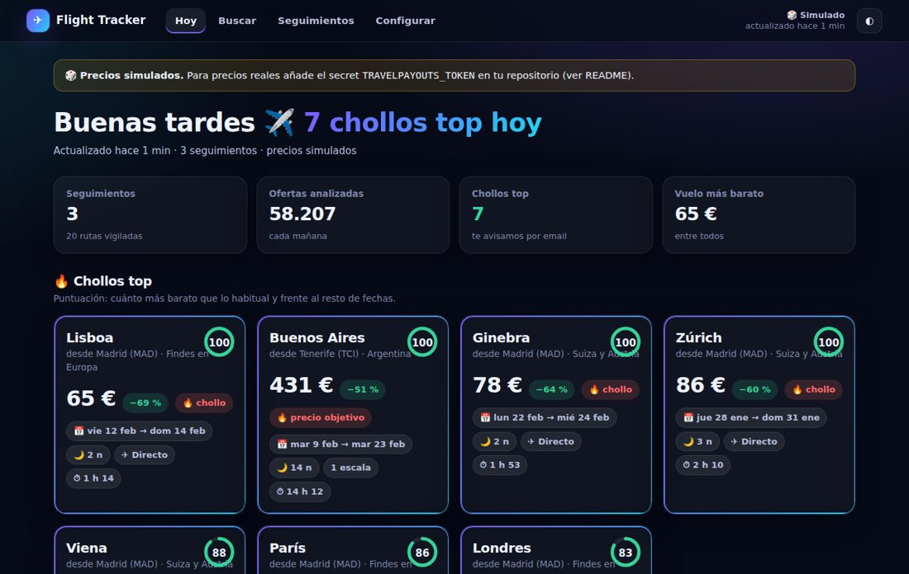
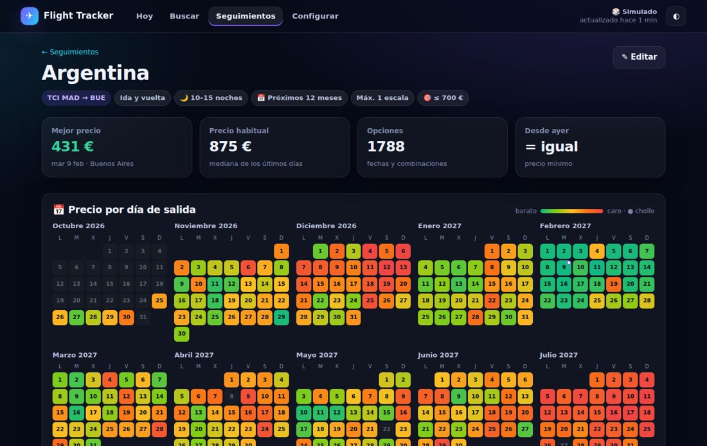
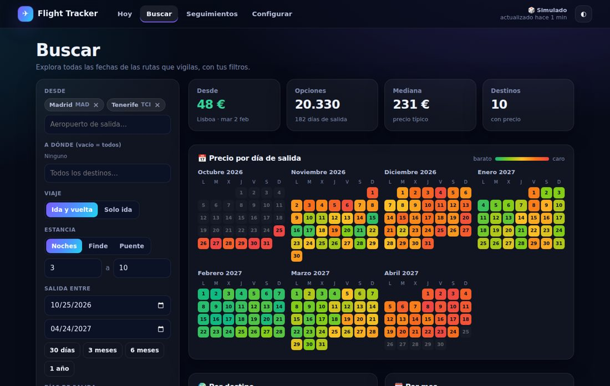
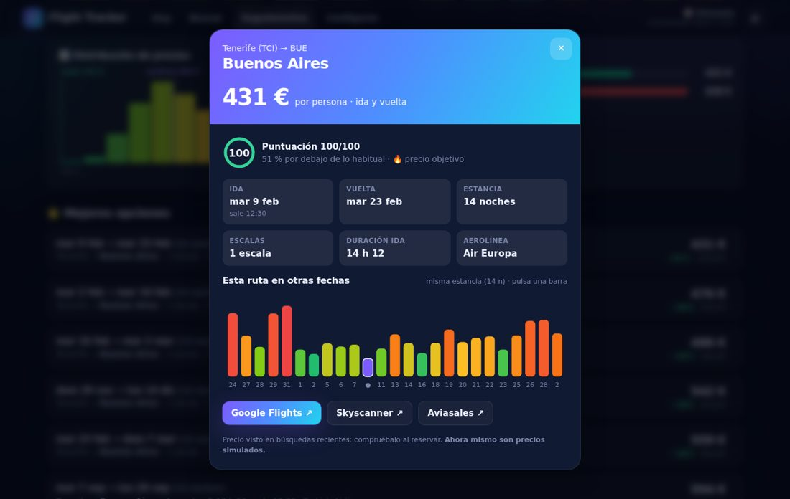

# ✈️ Flight Tracker

Mi buscador personal de chollos de vuelos. Funciona **entero en GitHub, gratis y sin ordenador encendido**:

- 🔎 **Cada mañana** busca los precios de mis *seguimientos* para todas las fechas.
  - Un seguimiento junta orígenes, destinos, fechas, estancia y escalas.
- 🌐 **Publica la web** en GitHub Pages, con gráficos y un buscador. Se ve bien en el portátil y en el móvil.
- 📧 **Me avisa por email** solo cuando hay un **chollo top**.

| Hoy | Un seguimiento |
|---|---|
|  |  |
| **Buscar** | **Ficha de un vuelo** |
|  |  |

## Qué puedo hacer

| Quiero… | Dónde |
|---|---|
| Elegir aeropuertos de **salida y destino** (también países enteros) | Configurar |
| Elegir **fechas**: próximos N meses o entre dos fechas, y días de salida | Configurar · Buscar |
| Elegir la **estancia**: nº de noches (o un rango), fin de semana vie→dom o puente | Configurar · Buscar |
| **Ida y vuelta** o **solo ida** | Configurar · Buscar |
| **Solo directos**, máx. 1 escala o cualquiera | Configurar · Buscar |
| Ver **gráficos** de precios (ver lista debajo) | Seguimientos |
| Buscar libremente entre todas las fechas de mis rutas | Buscar |
| Recibir un **email** cuando hay un chollo top | Automático |

Los gráficos de cada seguimiento son:
- calendario de precios de 12 meses;
- evolución diaria del precio;
- más barato por mes, por destino, por nº de noches, por día de la semana y por aeropuerto de salida;
- distribución de precios.

## Puesta en marcha (una vez)

1. **Sube estos ficheros** a tu repositorio de GitHub (debe ser **público** para que Pages sea gratis).
2. GitHub → **Settings → Pages → Source: «GitHub Actions»**.
3. **Precios reales:**
   - en GitHub → **Settings → Secrets and variables → Actions → New repository secret**, crea `TRAVELPAYOUTS_TOKEN`;
   - su valor es tu clave gratuita de [travelpayouts.com](https://www.travelpayouts.com) (Tools → API).
   - Sin clave, la web funciona con precios **simulados**.
4. GitHub → **Actions → «Actualizar vuelos» → Run workflow**. En unos minutos tienes la web en `https://<usuario>.github.io/<repositorio>/`.

A partir de ahí se actualiza sola **cada mañana a las 8:00 (hora de Madrid)**.

## Cambiar lo que vigilo

En la web, pestaña **Configurar**:
1. Edita o crea seguimientos.
2. Pulsa **Guardar en GitHub**. Se abre GitHub con los cambios ya escritos (tienes la sesión iniciada).
3. Pulsa **Create**.

El workflow «Guardar configuración» escribe `config.json`, busca precios y actualiza la web en unos minutos. No hay usuarios ni contraseñas: solo acepta cambios creados por el dueño del repositorio.

> Si actualizas el código más adelante, haz antes `git pull`: la web guarda tus seguimientos en `config.json`.

## Avisos por email

Te llega un email solo cuando un seguimiento tiene un **chollo top**:

- **Chollo:** puntuación ≥ 80/100 y un 25 % (configurable) por debajo del precio habitual. Además tiene que ser barato también frente a las fechas cercanas, para no avisar de algo que solo es temporada baja.
- **Precio objetivo:** por debajo del «Avisarme siempre por debajo de» del seguimiento.
- **Mínimo histórico:** el más barato visto nunca en ese seguimiento.

**Sin spam:**
- como mucho 3 chollos por seguimiento, y uno por destino;
- un seguimiento no vuelve a avisar en 14 días salvo que salga algo un 10 % más barato.

**Cómo llega:**
- Sin configurar nada: se publica una *issue* en tu repositorio que te menciona, y **GitHub te la manda al email de tu cuenta**. Comprueba en [github.com/settings/notifications](https://github.com/settings/notifications) que el email es el tuyo.
- Si prefieres que llegue desde tu propio Gmail, crea los secrets:
  - `GMAIL_ADDRESS`;
  - `GMAIL_APP_PASSWORD` (una [contraseña de aplicación](https://myaccount.google.com/apppasswords)).
- Para probarlo: **Actions → Actualizar vuelos → Run workflow** con «Enviarme un email de prueba».

## La puntuación de un vuelo (0–100)

- **55 %:** cuánto más barato es que el precio habitual del seguimiento (mediana de los últimos días).
- **45 %:** su posición frente a todas las fechas y combinaciones posibles.

## Estructura

```
config.json                  tus seguimientos (los cambia la web)
tracker/                     Python (solo usa «requests»)
  providers.py               Travelpayouts (real) · Demo (simulado)
  scan.py                    descarga en paralelo todas las rutas y meses
  analysis.py                filtros, puntuación, chollos y datos de los gráficos
  alerts.py                  emails de chollos
  build.py                   genera la web (datos JSON)
  data/airports.json         195 países y sus aeropuertos
web/                         la web (HTML/CSS/JS sin librerías; gráficos SVG propios)
.github/workflows/
  update.yml                 cada mañana: precios → avisos → web
  config.yml                 aplica los cambios hechos en «Configurar»
  tests.yml                  tests
tests/                       python -m unittest discover -s tests
```

**Probar en local (opcional):** `python -m tracker demo site`, luego `python -m http.server -d site` y abre http://localhost:8000.

Los precios son de búsquedas recientes en Aviasales (Travelpayouts): compruébalos siempre al reservar.
